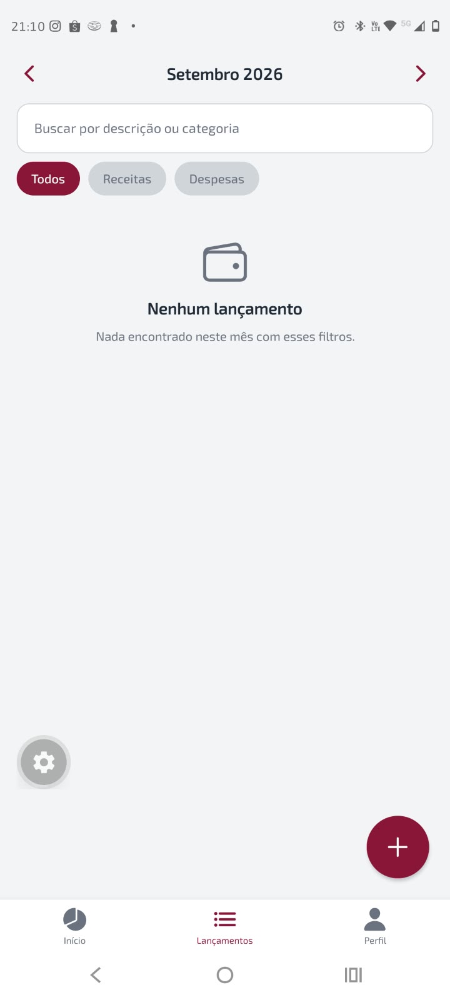

# SmartPig

Aplicativo mobile de gerenciamento financeiro com integração ao Open Finance. Registre receitas e despesas, acompanhe sua movimentação mensal e, se desejar, importe lançamentos bancários.

## Funcionalidades

- Cadastro, login e persistência de sessão com Supabase Auth
- Criação, edição e exclusão de receitas e despesas
- Conexão com instituições financeiras e importação de lançamentos via Pluggy
- Painel mensal com saldo, receitas, despesas e gráfico por categoria
- Lista de transações agrupada por dia, com busca e filtro por tipo
- Exportação de transações em CSV
- Isolamento dos dados por usuário com Row Level Security (RLS)

## Tecnologias

React Native · Expo · Expo Router · TypeScript · Supabase (Auth, Postgres, RLS e Edge Functions) · Pluggy · TanStack Query · React Hook Form · Zod · react-native-svg · Jest

## Capturas de tela

| Início                                        | Lançamentos                                    | Contas bancárias                      |
| --------------------------------------------- | ---------------------------------------------- | ------------------------------------- |
|  |  |  |

## Pré-requisitos

- Node.js e npm
- Uma conta e um projeto no [Supabase](https://supabase.com)
- [Expo Go](https://expo.dev/go) no celular para executar o aplicativo

## Instale no seu dispositivo

https://expo.dev/accounts/joaoaeneto/projects/smartpig/builds/5e0ea643-94a8-4853-96c9-ffeec6345a0e


## Como executar

1. Na raiz do repositório, entre na pasta do aplicativo e instale as dependências:

   ```bash
   cd fintrack
   npm install
   ```

2. No painel do Supabase, abra o **SQL Editor** e execute os arquivos `supabase/schema.sql` e `supabase/open-finance.sql`, nessa ordem.

3. Crie o arquivo de ambiente a partir do modelo:

   ```bash
   cp .env.example .env
   ```

   No Windows PowerShell, use `Copy-Item .env.example .env`. Edite `.env` e informe os valores do seu projeto Supabase:

   ```dotenv
   EXPO_PUBLIC_SUPABASE_URL=https://SEU-PROJETO.supabase.co
   EXPO_PUBLIC_SUPABASE_KEY=SUA-CHAVE-PUBLICA
   EXPO_PUBLIC_OPEN_FINANCE_SANDBOX=true
   ```

   A chave pública do Supabase (anon/publishable) pode ser usada no aplicativo. **Nunca coloque chaves secretas ou `service_role` em variáveis `EXPO_PUBLIC_` ou no código do app.**

4. Inicie o Expo:

   ```bash
   npx expo start
   ```

   Abra o projeto no Expo Go ou use as opções exibidas no terminal para iniciar em um emulador.

## Configurar o Open Finance

O uso do Open Finance é opcional. Para habilitá-lo, crie uma aplicação no [painel da Pluggy](https://dashboard.pluggy.ai) e configure as credenciais como secrets das Edge Functions do Supabase. Execute os comandos a partir da pasta `fintrack`:

```bash
npx supabase login
npx supabase link --project-ref SEU-PROJECT-REF
npx supabase secrets set PLUGGY_CLIENT_ID=SEU-CLIENT-ID PLUGGY_CLIENT_SECRET=SEU-CLIENT-SECRET
npx supabase functions deploy bank-connect-token
npx supabase functions deploy bank-sync
npx supabase functions deploy bank-disconnect
```

Por padrão, `EXPO_PUBLIC_OPEN_FINANCE_SANDBOX` fica em `true`, habilitando instituições de teste. Para desativar o sandbox, defina a variável como `false` e reinicie o Expo.

O fluxo de conexão e importação é:

```text
app -> bank-connect-token -> Pluggy (token temporário)
app -> widget Pluggy -> consentimento do usuário
app -> bank-sync -> Pluggy -> transações
app -> bank-disconnect -> desconexão da instituição
```

As credenciais da Pluggy ficam nos secrets das Edge Functions, não no aplicativo. A função de sincronização valida a conexão com o usuário autenticado antes de importar os dados.

## Scripts

Execute estes comandos dentro da pasta `fintrack`:

| Comando             | Descrição                                                      |
| ------------------- | -------------------------------------------------------------- |
| `npm start`         | Inicia o servidor de desenvolvimento do Expo                   |
| `npm run android`   | Inicia o Expo direcionado a um emulador ou dispositivo Android |
| `npm run ios`       | Inicia o Expo direcionado ao simulador ou dispositivo iOS      |
| `npm test`          | Executa os testes com Jest                                     |
| `npm run typecheck` | Verifica os tipos TypeScript                                   |
| `npm run lint`      | Executa o ESLint                                               |
| `npm run format`    | Formata os arquivos TypeScript do app, testes e Edge Functions |

## Sobre o projeto

Projeto desenvolvido para a disciplina de Programação para Dispositivos Móveis do curso de Análise e Desenvolvimento de Sistemas (ADS) do IESB.

- **Autor:** João Augusto E. Neto
- **LinkedIn:** [João Augusto Evangelista Neto](https://www.linkedin.com/in/jo%C3%A3o-augusto-evangelista-neto-586230360)
- **GitHub:** [joaoaugustoneto](https://github.com/joaoaugustoneto)
